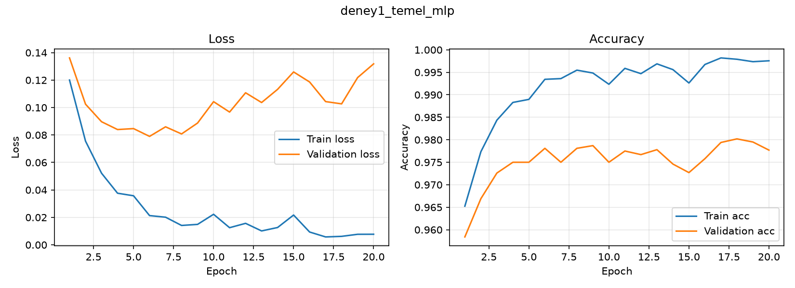
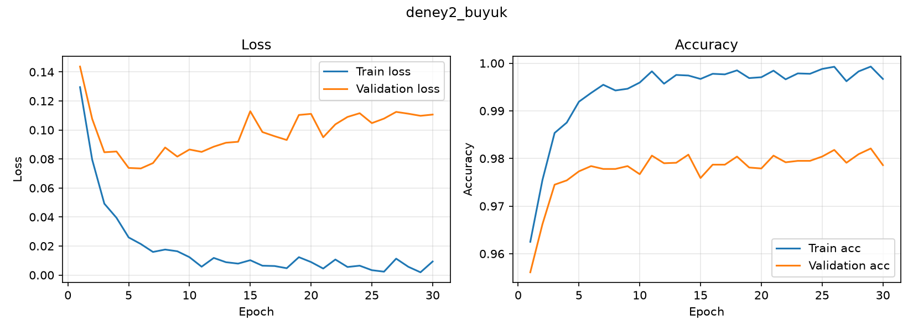
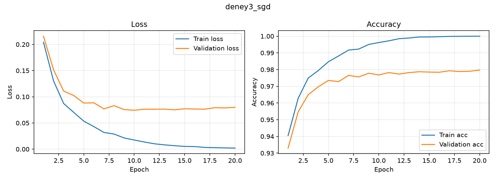
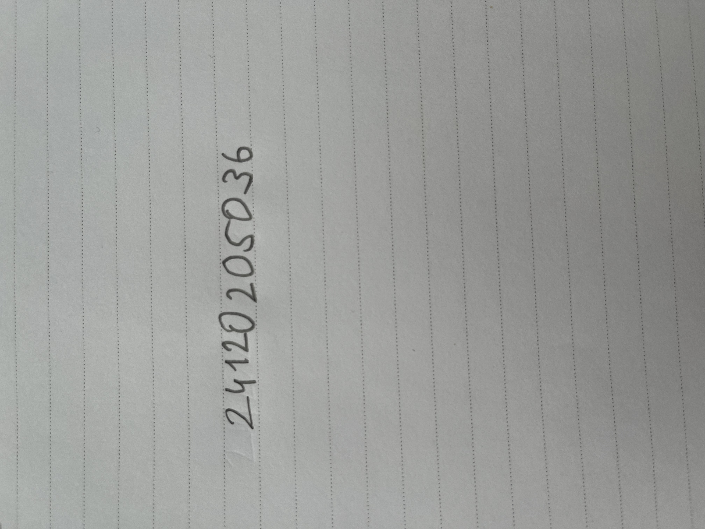
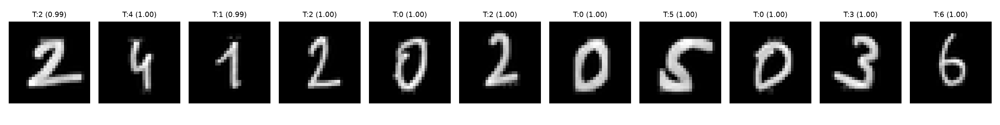

# MNIST ile MLP Tabanlı El Yazısı Rakam Tanıma

Bu projede MNIST veri seti üzerinde **sıfırdan** eğitilen Multi-Layer Perceptron (MLP) modelleri
bulunur. CNN ve hazır eğitilmiş model kullanılmamıştır. Framework: PyTorch (CPU üzerinde çalıştırıldı).

## Kurulum ve çalıştırma

```bash
python -m venv .venv
.venv\Scripts\Activate.ps1          # Windows PowerShell (Linux/macOS: source .venv/bin/activate)
pip install -r requirements.txt

# Deney 1 - temel MLP (MNIST ilk çalıştırmada otomatik indirilir)
python mlp_mnist.py

# Deney 2 ve 3 - farklı yapılandırmalar
python mlp_mnist.py --hidden 512 256 --lr 0.0005 --epochs 30 --name deney2_buyuk
python mlp_mnist.py --optimizer sgd --lr 0.01 --name deney3_sgd

# Kendi el yazımla öğrenci numarası tahmini
python predict_custom.py custom_digits\numara.png --segment --truth 24120205036
```

Dosyalar: `mlp_mnist.py` (model, eğitim, değerlendirme, grafikler), `predict_custom.py`
(el yazısı önişleme ve tahmin), `results/` (grafikler, metrikler, modeller), `custom_digits/` (el yazım).

## Veri ayrımı

| Küme | Boyut | Kullanım |
|---|---|---|
| Train | 50.000 | Ağırlık güncelleme |
| Validation | 10.000 | Epoch başına izleme ve yapılandırma karşılaştırması |
| Test | 10.000 | Yalnızca eğitim bittikten sonra **bir kez** ölçülür |

Train/validation ayrımı MNIST'in 60.000'lik eğitim kümesinden sabit seed (42) ile yapılır.
MNIST'in 10.000'lik test kümesi eğitim ve model seçimi sırasında kullanılmaz; her deneyin sonunda
yalnızca bir kez değerlendirilir. Girdiler `(x/255 − 0.1307) / 0.3081` ile normalize edilir.

## Deneyler

Ortak ayarlar: ReLU, CrossEntropyLoss (softmax kayıpla birlikte), batch size 128, dropout 0, seed 42,
her epoch sonunda tüm train ve validation kümeleri `eval` modunda ölçülür.

| | Deney 1: Temel | Deney 2: Büyük | Deney 3: SGD |
|---|---|---|---|
| Hidden layer'lar | 256 → 128 | 512 → 256 | 256 → 128 |
| Optimizer | Adam | Adam | SGD (momentum 0.9) |
| Learning rate | 0.001 | 0.0005 | 0.01 |
| Epoch | 20 | 30 | 20 |

### Sonuçlar (son epoch)

| Metrik | Deney 1 | Deney 2 | Deney 3 |
|---|---|---|---|
| Training loss | 0.0077 | 0.0093 | 0.0020 |
| Validation loss | 0.1318 | 0.1106 | 0.0798 |
| Training accuracy | %99.76 | %99.67 | %100.00 |
| Validation accuracy | %97.77 | %97.86 | %97.97 |
| Test loss | 0.1280 | 0.1175 | 0.0707 |
| Test accuracy | %97.79 | %97.70 | %98.00 |
| Eğitim süresi | 54.6 sn | 77.2 sn | 14.8 sn |

### Eğitim grafikleri

Deney 1 (temel MLP):



Deney 2 (daha büyük model):



Deney 3 (SGD):



### Deneylerin yorumu

- **Overfitting var.** Üç deneyde de training accuracy %99.7–100'e ulaşırken validation accuracy
  yaklaşık %97.8–98'de kalıyor. Deney 1'de training loss 0.12'den 0.008'e düşerken validation loss en
  düşük değerine 6. epoch'ta (0.079) ulaşıp sonra 0.13'e kadar yükseliyor. Model eğitim verisini
  ezberlemeye başlıyor; validation accuracy bu sırada neredeyse sabit kalıyor, ama loss artıyor
  (model yanlışlarında daha emin hale geliyor).
- **Deney 2 (daha büyük model)** daha uzun sürdü (77 sn) ama test accuracy'si temel modele göre
  artmadı (%97.70 ve %97.79). Parametre sayısını artırmak bu veri ve bu eğitim süresinde işe yaramadı.
- **Deney 3 (SGD)** en kararlı olanı: validation loss yaklaşık 0.075–0.080 civarında düz kalıyor
  (en düşüğü 10. epoch'ta 0.074), Adam'lı deneylerde ise epoch'lar arasında daha çok dalgalanıyor.
  Training accuracy %100'e ulaşmasına rağmen validation loss Adam'lı deneylerdeki kadar yükselmedi.
- **Yapılandırma seçimi validation'a göre yapılır.** Validation accuracy ve loss en iyi Deney 3'te.
  Test sonucu yalnızca raporlanır, seçim için kullanılmaz.
- **Farklar küçük.** Üç test accuracy değeri %0.3 içinde (%97.70–%98.00). Her yapılandırma tek seed
  ile çalıştırıldığı için bu fark rastgelelikten de kaynaklanabilir; "SGD kesinlikle daha iyi" yerine
  "benzer, SGD biraz önde" demek daha doğru olur. Süre farkı kısmen optimizer'a, kısmen
  bilgisayarın o anki yüküne bağlı olabilir.

## Kendi el yazım

`custom_digits/numara.png` dosyasında öğrenci numaramı (24120205036) kendi el yazımla çizgili kâğıda
yazıp telefonla çektiğim fotoğraf bulunur.



### Önişleme (MNIST'e benzetme)

`predict_custom.py` fotoğrafı şu adımlarla MNIST formatına çevirir:

1. Telefonun EXIF dönüş bilgisi uygulanır (dikey çekilen fotoğraf aksi halde yan okunuyordu).
2. Gri tonlama; arka plan (gölge, kâğıt tonu) bulanıklaştırma ile tahmin edilip çıkarılır.
3. Koyu kalem, soluk kâğıt çizgilerinden ikinci bir Otsu eşiği ile ayrılır ve yalnızca rakam
   satırı alınır. Böylece zemin siyah, rakamlar beyaz olur (MNIST formatı).
4. Rakamlar kolon yoğunluğundaki boşluklardan ayrılır. Birbirine değen rakamlar (20 ve 50), bilinen
   rakam sayısı (11) kullanılarak kolon yoğunluğunun en düşük olduğu yerden bölünür.
5. Her rakam sınırlarına kırpılır, ince kalem çizgisi MNIST'e benzer kalınlığa getirilir, en-boy
   oranı korunarak 20×20'ye sığdırılır ve kütle merkezine göre 28×28 tuvalin ortasına yerleştirilir.
6. MNIST ortalama ve standart sapması ile normalizasyon uygulanır.

Segmentleme sonucu (kırmızı: rakamın başı, mavi: sonu):


### Sonuç

Tahmin için Deney 1 modeli (`results/deney1_temel_mlp.pt`) kullanıldı. Modelin gördüğü 28×28
görüntüler ve her rakam için tahmin edilen sınıf ile olasılığı:



| Gerçek numara | 24120205036 |
|---|---|
| Tahmin | 24120205036 |
| Doğru rakam | 11/11 (%100) |

### Önişleme sürecinde yaşananlar

Sonuca tek seferde ulaşılmadı:

1. İlk denemede betik rakamları ayıramadı (fotoğraf yan okunuyor, noktalı çizgiler rakam satırından
   geçiyor, bazı rakamlar birbirine değiyordu) ve 1/11 doğru çıktı.
2. Segmentleme düzeltilince 9/11 oldu: "4" ve "1" yanlış tahmin edildi (ikisi de "9"). İncelediğimde
   ince kalemi kalınlaştırma adımının dar rakamları kalın bir lekeye çevirdiğini gördüm.
   Kalınlaştırmayı rakamın yoğunluğuna değil çizgi genişliğine göre yapınca "4" ve "1" doğru çıktı
   ve sonuç 11/11 oldu.

Önişleme ayarları bu fotoğrafın sonuçlarına bakılarak yapıldı. Bu yüzden %100 sonucu modelin her el
yazısında böyle başarılı olacağını göstermez.

## Genel değerlendirme

- **MNIST başarısı ve el yazısı başarısı farklı şeyleri ölçer.** MNIST test kümesinde (10.000 örnek)
  model yaklaşık %97.7–98.0 doğruluğa ulaştı. Kendi numaramda 11 rakamda 11 doğru elde edildi, ama
  bu yalnızca 11 örnek: istatistiksel olarak MNIST test sonucuyla kıyaslanabilecek kadar güçlü
  bir ölçüm değil.
- **Distribution shift (veri dağılımı kayması) önişleme ile azaltıldı.** MNIST'teki rakamlar
  ortalanmış, siyah zeminde beyaz ve belirli kalınlıktadır. Benim verim ise çizgili kâğıtta, gölgeli,
  ince kalemle yazılmış ve birbirine değen rakamlardan oluşuyordu. İlk denemelerde modelin değil
  önişlemenin hatası belirleyici oldu: rakamları ayırmak, zemin ve çizgileri temizlemek, kalınlık ve
  konumu MNIST'e yaklaştırmak sonucu 1/11'den 11/11'e taşıdı. Önişlemeyi hiç yapmadan bu fotoğrafın
  modele verilmesini denemedim; bu yüzden önişlemenin ne kadar etkili olduğunu bu çalışmadan
  yalnızca iyi ve kötü denemeler arasındaki fark üzerinden söyleyebiliyorum.
- **MLP'nin sınırı.** MLP girdiyi düz bir vektör olarak alır; rakamın konumu, kalınlığı veya biçimi
  değiştiğinde piksel örüntüsü değişir. Bu yüzden önişleme (ortalama, ölçekleme, kalınlık) MLP için
  özellikle önemli. Bu ödevde CNN kullanılmadığı için CNN ile bir karşılaştırma yapılmadı.
- **Overfitting.** Eğitim doğruluğu yaklaşık %100 iken validation doğruluğu yaklaşık %98'de kaldı.
  Dropout, weight decay veya erken durdurma (validation loss'un en düşük olduğu epoch'ta durma) bu
  boşluğu azaltmak için denenebilir; bu ödevde denenmedi.
- **Sınırlar.** Her yapılandırma tek seed ile çalıştırıldı, yapılandırmalar arasındaki küçük farklar
  rastgelelikten olabilir. El yazısı testi tek bir kişinin tek bir fotoğrafıyla yapıldı ve önişleme
  bu fotoğraf üzerinde ayarlandı.

## Kurallara uyum

- CNN kullanılmadı; model yalnızca tam bağlı (Linear) katmanlardan oluşur.
- Hazır eğitilmiş model kullanılmadı, model sıfırdan eğitildi.
- Train/validation/test ayrımı açıkça gösterildi; test kümesi yalnızca bir kez, eğitim sonunda kullanıldı.
- El yazısı görüntüsü bana aittir; kullanılan hiperparametreler yukarıdaki tablodadır.
